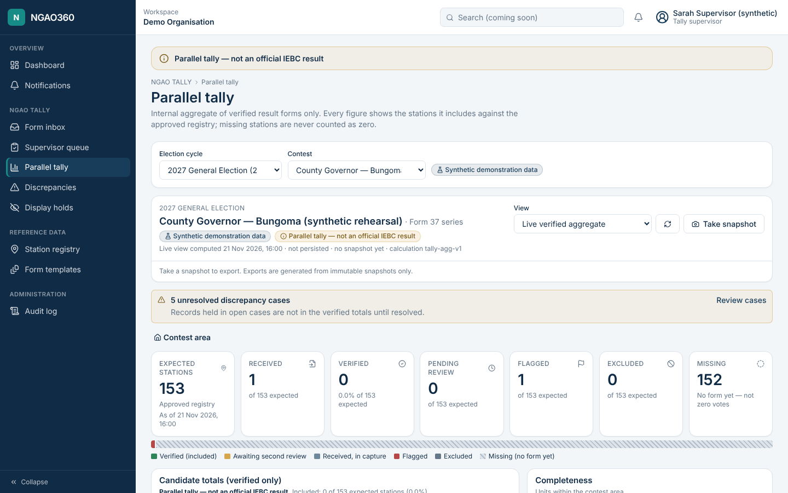

# NGAO360

NGAO360 is a private operations platform for political organisations and elected offices: campaign and office operations, election-day field work, and **NGAO TALLY**, an independent system for keeping parallel records of result forms and checking them.

> **NGAO TALLY is a parallel tally. It is never an official IEBC result.** The IEBC is the only authority that declares and certifies results. NGAO360 never uses winner, elected or declared language, never issues certificates, and labels every aggregate, snapshot and export as an internal parallel tally.

## Scope boundary

NGAO360 **is**:

- a multi-tenant workspace with roles, geography-scoped access, separation of duties and an append-only audit log;
- a reference-data registry: election cycles, counties down to polling stations (versioned, approved registry imports), contests, candidates and approved form templates for all six positions (34–39 series);
- NGAO TALLY: form intake, where originals are stored unchanged and SHA-256 hashed; manual capture with optional OCR drafts; validation; independent second review; discrepancy cases; immutable snapshots; and exports labelled as non-official.

NGAO360 **is not**: an election management body, a voter register, a KIEMS replacement, an official results-transmission channel or a declaration authority. It never captures IEBC certificates (34D/35C/36C/37D/38D/39D), and it never alters, hides or discards a source record.

What this build covers (see [docs/DECISIONS.md](docs/DECISIONS.md)):

- **Platform:** platform foundation and NGAO TALLY MVP (roadmap stages 1 and 4).
- **First rehearsal:** County Governor (Forms 37A, 37B and 37C).
- **Demo data:** all synthetic. Fictional candidates, a synthetic Bungoma registry of 153 stations, invented figures. Only the 47 county codes and names are real public reference data.

## Quick start

Prerequisites: Node 22, pnpm 10, PostgreSQL 16 and Redis 7. You can run local binaries or `docker compose -f docker-compose.dev.yml up -d`. [docs/DEVELOPMENT.md](docs/DEVELOPMENT.md) has the full setup, including running a throwaway Postgres cluster under `/tmp` without Docker.

```bash
pnpm install && cp .env.example .env
psql -h 127.0.0.1 -p 5433 -U postgres -f scripts/db-bootstrap.sql   # roles + databases (once per cluster)
pnpm db:migrate
SEED_DEMO_MFA=preenrolled pnpm db:seed   # synthetic demo data; shared dev TOTP for privileged users
pnpm dev                                 # API http://localhost:4000/api, web http://localhost:3000
```

Checks:

```bash
pnpm typecheck && pnpm lint && pnpm build
pnpm test                         # unit + DB integration tests (integration runs when TEST_* URLs are set)
pnpm smoke:web                    # Playwright smoke against the running app; writes docs/screenshots/
```

To run the Governor rehearsal on its own: `pnpm test:rehearsal`. It runs the whole flow through the API: upload, capture, a separation-of-duties refusal, verification, an arithmetic discrepancy, the snapshot, an export, a 37B cross-stage variance case and the audit trail.

## Demo accounts (synthetic)

Organisation code **`demo`**. The password for every account is `SEED_DEMO_PASSWORD`, which defaults to `Demo-Password-2027`. With `SEED_DEMO_MFA=preenrolled`, users marked TOTP share the development-only secret `JBSWY3DPEHPK3PXPJBSWY3DPEHPK3PXP`. Add it to any authenticator app. With the default (`disabled`), those users set up an authenticator the first time they sign in.

| Email | Role | Scope | MFA |
| --- | --- | --- | --- |
| `owner@demo.example.org` | Organisation owner | Organisation | TOTP |
| `director@demo.example.org` | Campaign director | Organisation | TOTP |
| `ops@demo.example.org` | Operations director | Organisation | none |
| `lead@demo.example.org` | Department lead | Organisation | none |
| `coordinator@demo.example.org` | Coordinator | Synthetic Constituency North | none |
| `agent1@`, `agent2@demo.example.org` | Polling agent | One station each | none |
| `clerk@`, `clerk2@demo.example.org` | Data-entry clerk | Organisation | none |
| `verifier@demo.example.org` | Results verifier | Organisation | TOTP |
| `verifier.north@demo.example.org` | Results verifier | Synthetic Constituency North | TOTP |
| `supervisor@demo.example.org` | Tally supervisor | Organisation | TOTP |
| `legal@demo.example.org` | Legal/compliance officer (approves form templates) | Organisation | TOTP |
| `finance@demo.example.org` | Finance officer | Organisation | TOTP |
| `comms@demo.example.org` | Communications editor | Organisation | none |

Other tenants: `platform` (`operator@platform.example.org`, platform operator) and `other` (`owner@other.example.org`, used to test cross-tenant isolation).

A short walkthrough: sign in as the clerk and upload `fixtures/forms/synthetic-37a-*.png` from **Form inbox**, then capture the figures and submit for review. Next, sign in as the verifier to verify the form. Finally, sign in as the supervisor and open **Parallel tally**: totals include only verified stations, measured against the 153 stations in the approved registry.

## Repository

| Path | What |
| --- | --- |
| `apps/api` | NestJS API: auth (JWT cookies, TOTP, re-auth), RBAC and geography guard, reference, tally and admin modules, BullMQ workers |
| `apps/web` | Next.js PWA: command centre, NGAO TALLY screens S18–S22, admin and reference screens |
| `packages/db` | Prisma schema, migrations with row-level security and immutability triggers, synthetic seed |
| `packages/shared` | zod contracts, permissions and roles, form-template catalogue, validation-rule evaluator |
| `fixtures/` | Synthetic registry CSVs and rehearsal form images |
| `infra/`, `docker-compose*.yml` | Container deployment |

Docs: [blueprint](docs/BLUEPRINT.md) · [decisions](docs/DECISIONS.md) · [architecture](docs/ARCHITECTURE.md) · [API contract](docs/API_CONTRACT.md) · [development](docs/DEVELOPMENT.md) · [change requests](docs/CHANGE_REQUESTS.md) · [open questions](docs/QUESTIONS.md)


