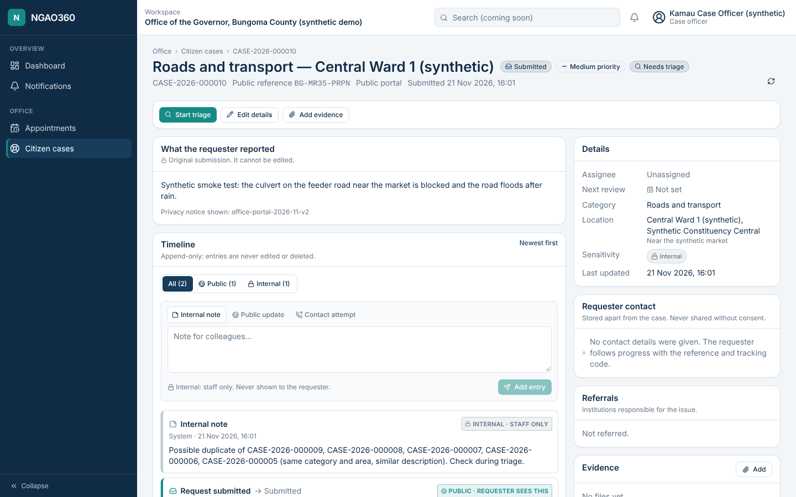

# NGAO360

NGAO360 is a private operations platform for political organisations and elected offices: campaign and office operations, election-day field work, and **NGAO TALLY**, an independent system for keeping parallel records of result forms and checking them.

> **NGAO TALLY is a parallel tally. It is never an official IEBC result.** The IEBC is the only authority that declares and certifies results. NGAO360 never uses winner, elected or declared language, never issues certificates, and labels every aggregate, snapshot and export as an internal parallel tally.

## Scope boundary

NGAO360 **is**:

- a multi-tenant workspace with roles, geography-scoped access, separation of duties and an append-only audit log;
- a reference-data registry: election cycles, counties down to polling stations (versioned, approved registry imports), contests, candidates and approved form templates for all six positions (34–39 series);
- NGAO TALLY: form intake, where originals are stored unchanged and SHA-256 hashed; manual capture with optional OCR drafts; validation; independent second review; discrepancy cases; immutable snapshots; and exports labelled as non-official;
- **NGAO360 Office** for an elected office (pilot: a County Governor's office): correspondence register, appointments and lean meetings, citizen cases with a public request portal and tracking page, and a project register with independent verification and a public project view. Office data sits in its own tables behind its own `office.*` permissions, apart from campaign and tally data (blueprint 15.2), and the module can be switched off per organisation.

NGAO360 **is not**: an election management body, a voter register, a KIEMS replacement, an official results-transmission channel or a declaration authority. It never captures IEBC certificates (34D/35C/36C/37D/38D/39D), and it never alters, hides or discards a source record.

What this build covers (see [docs/DECISIONS.md](docs/DECISIONS.md)):

- **Platform:** platform foundation, NGAO TALLY MVP, NGAO360 Office and field and election operations (roadmap stages 1, 3, 4 and 5).
- **Rehearsals:** County Governor tally (Forms 37A, 37B and 37C), a County Governor's office (citizen request to closure, project to verified public view) and election day in the field (deployment to War Room).
- **Demo data:** all synthetic. Fictional candidates, a synthetic Bungoma registry of 153 stations, invented figures. Only the 47 county codes and names are real public reference data.

## Quick start

Prerequisites: Node 22, pnpm 10, PostgreSQL 16 and Redis 7. You can run local binaries or `docker compose -f docker-compose.dev.yml up -d`. [docs/DEVELOPMENT.md](docs/DEVELOPMENT.md) has the full setup, including running a throwaway Postgres cluster under `/tmp` without Docker.

```bash
pnpm install && cp .env.example .env
psql -h 127.0.0.1 -p 5433 -U postgres -f scripts/db-bootstrap.sql   # roles + databases (once per cluster)
pnpm db:migrate
SEED_DEMO_MFA=preenrolled pnpm db:seed   # synthetic demo data; shared dev TOTP for privileged users
pnpm dev                                 # API http://localhost:4000/api, web http://localhost:3000
```

Checks:

```bash
pnpm typecheck && pnpm lint && pnpm build
pnpm test                         # unit + DB integration tests (integration runs when TEST_* URLs are set)
pnpm smoke:web                    # Playwright smoke against the running app; writes docs/screenshots/
pnpm smoke:office                 # Office smoke: public portal, case workspace, project register; docs/screenshots/office-*.png
pnpm smoke:field                  # Field smoke: War Room, planner, masked agent profile, /m and the offline queue; docs/screenshots/field-*.png
```

To run the Governor rehearsal on its own: `pnpm test:rehearsal`. It runs the whole flow through the API: upload, capture, a separation-of-duties refusal, verification, an arithmetic discrepancy, the snapshot, an export, a 37B cross-stage variance case and the audit trail.

The Office rehearsal is `pnpm test:rehearsal:office`: a citizen submits a request on the public portal without an account, the office administrator triages and assigns it, the case officer refers it to the responsible institution and proposes a resolution, the citizen tracks it and sees only public updates, and a second person closes it. A project is recorded with its responsible institution, evidence is verified by someone other than the uploader, a photograph alone is refused as proof of completion, and the public page shows only the fields the public-information editor approved.

The election-day rehearsal is `pnpm test:rehearsal:field`: the planner deploys agents and leaves a coverage gap, readiness checklists are completed for some stations, an agent checks in and sends the opening-of-polls report through the offline sync endpoint twice (the duplicate is recognised and applied once), the agent reports a high-severity incident, the incident desk triages, escalates and resolves it and a second person closes it, and the War Room shows station statuses, coverage, incidents and tally intake, labelled unofficial / internal, with stations that sent nothing counted as missing, never as zero. It ends by checking that an agent cannot report for a station they are not deployed to.

## Demo accounts (synthetic)

Organisation code **`demo`**. The password for every account is `SEED_DEMO_PASSWORD`, which defaults to `Demo-Password-2027`. With `SEED_DEMO_MFA=preenrolled`, users marked TOTP share the development-only secret `JBSWY3DPEHPK3PXPJBSWY3DPEHPK3PXP`. Add it to any authenticator app. With the default (`disabled`), those users set up an authenticator the first time they sign in.

| Email | Role | Scope | MFA |
| --- | --- | --- | --- |
| `owner@demo.example.org` | Organisation owner | Organisation | TOTP |
| `director@demo.example.org` | Campaign director | Organisation | TOTP |
| `ops@demo.example.org` | Operations director | Organisation | none |
| `lead@demo.example.org` | Department lead | Organisation | none |
| `coordinator@demo.example.org` | Coordinator | Synthetic Constituency North | none |
| `agent1@`, `agent2@demo.example.org` | Polling agent (mobile field app `/m`; agent records AGT-2027-000001/2, chief agents of the first two stations) | One station each (by station code) | none |
| `clerk@`, `clerk2@demo.example.org` | Data-entry clerk | Organisation | none |
| `verifier@demo.example.org` | Results verifier | Organisation | TOTP |
| `verifier.north@demo.example.org` | Results verifier | Synthetic Constituency North | TOTP |
| `supervisor@demo.example.org` | Tally supervisor | Organisation | TOTP |
| `legal@demo.example.org` | Legal/compliance officer (approves form templates) | Organisation | TOTP |
| `finance@demo.example.org` | Finance officer | Organisation | TOTP |
| `comms@demo.example.org` | Communications editor | Organisation | none |
| `field@demo.example.org` | Field coordinator (may reveal agent personal data, audited) | Organisation | TOTP |
| `field.north@demo.example.org` | Field coordinator | Synthetic Constituency North (2027 cycle) | TOTP |
| `planner@demo.example.org` | Deployment planner | Organisation | none |
| `incidents@demo.example.org` | Incident desk officer | Organisation | none |
| `commander@demo.example.org` | War Room commander | Organisation | TOTP |
| `observer@demo.example.org` | War Room observer | Organisation | none |

The `demo` tenant also has the `field` module on with synthetic field data: 120 agents, about 100 deployments with deliberate gaps (uncovered stations), readiness checklists in mixed states, two active report templates, 30 field reports, 25 incidents across severities and statuses and War Room station statuses.

### Field and election operations (synthetic, tenant `demo`)

| Where | Who | What |
| --- | --- | --- |
| `/field/agents`, `/field/agents/[id]` (S13) | `planner@`, `field@` | Agent registry and profile. Phone, ID, M-Pesa number and next of kin are masked; `field@` may reveal them (reason + password, audited, hidden again after 60 s). |
| `/field/deployment` (S14) | `planner@` | Every approved-registry station with coverage, "Not assigned" gaps and conflicts; assign by selection, drag or in bulk; roster export with masked phones. |
| `/field/readiness` (S15) | `field@`, `field.north@` | Checklists per station; stations without one count as "not started", never ready. |
| `/field/incidents[/id]` | `incidents@` | Incident desk: triage, assign, escalate, resolve; the original report is locked and corrections are added beside it; closure by a second person. |
| `/warroom` (S16) | `commander@` (TOTP), `observer@` | Six panels, each labelled unofficial / internal with completeness; missing stations shown as missing, never zero; tally figures "not available" without tally access. |
| `/dashboard` | holders of field or War Room permissions | Field operations card (readiness, gaps, open incidents, War Room stations reporting) and the agent-coverage KPI. |
| `/m` (S11, S17) | `agent1@`, `agent2@` | Mobile field app: my station, check-in, opening/closing report, incident report and an encrypted offline queue that uploads with idempotency keys and shows conflicts for a decision. |

Offline queue: items are sealed with AES-GCM under a non-extractable per-user key in IndexedDB; this protects only against other origins and casual inspection of the stored records, not against a copy of the browser profile (the key material is stored beside the ciphertext) or someone using the phone (a PIN-wrapped key is the priority next step). Uploads run while a tab is open. See docs/ARCHITECTURE.md §14 and docs/STATUS.md.

Other tenants: `platform` (`operator@platform.example.org`, platform operator) and `other` (`owner@other.example.org`, used to test cross-tenant isolation).

### NGAO360 Office demo (synthetic County Governor's office, Bungoma)

Organisation code **`bungoma-governor`**, same password. The `office` module and the public portal are on; `tally` is off in this tenant (campaign and tally data stay in `demo`, blueprint 15.2). The public portal is at `/p/bungoma-governor` (no sign-in); the seed prints a synthetic reference and tracking code to try on `/p/bungoma-governor/track`.

| Email (`@bungoma-office.example.org`) | Role | Scope | MFA |
| --- | --- | --- | --- |
| `owner@` | Organisation owner (module activation, read-only office oversight) | Organisation | TOTP |
| `officeadmin@` | Office administrator (triage, closure, confidential correspondence, verification) | Organisation | TOTP |
| `caseofficer@` | Case officer | Organisation | none |
| `caseofficer.north@` | Case officer | Synthetic Constituency North | none |
| `clerk@` | Correspondence clerk (also keeps the diary) | Organisation | none |
| `projects@` | Projects officer (records and evidence; cannot verify or publish) | Organisation | none |
| `publicinfo@` | Public-information editor (publishes approved project fields) | Organisation | TOTP |

Office walkthrough: open `/p/bungoma-governor/request` in a private window and send a request (no account; read the privacy notice, choose "Do not contact me" if you like). Keep the reference and tracking code from the receipt and open **Track a request**. Then sign in as `officeadmin@` (TOTP), open **Citizen cases**, triage the request and assign it to the case officer; sign in as `caseofficer@` to add a public update, refer it and propose a resolution; track it again as the citizen. For projects, sign in as `projects@` and open **Projects**; verification needs `officeadmin@` and publishing needs `publicinfo@`. The public project pages are at `/p/bungoma-governor/projects`. Office staff land on an Office overview on the dashboard.

Tally walkthrough: sign in as the clerk and upload `fixtures/forms/synthetic-37a-*.png` from **Form inbox**, then capture the figures and submit for review. Next, sign in as the verifier to verify the form. Finally, sign in as the supervisor and open **Parallel tally**: totals include only verified stations, measured against the 153 stations in the approved registry.

## Repository

| Path | What |
| --- | --- |
| `apps/api` | NestJS API: auth (JWT cookies, TOTP, re-auth), RBAC and geography guard, reference, tally, office (with the public portal) and admin modules, BullMQ workers |
| `apps/web` | Next.js PWA: command centre, NGAO TALLY screens S18–S22, Office screens S23–S27 and the public portal (`/p/[tenantSlug]`), admin and reference screens |
| `packages/db` | Prisma schema, migrations with row-level security and immutability triggers, synthetic seed |
| `packages/shared` | zod contracts, permissions and roles, form-template catalogue, validation-rule evaluator |
| `fixtures/` | Synthetic registry CSVs and rehearsal form images |
| `infra/`, `docker-compose*.yml` | Container deployment |

Docs: [blueprint](docs/BLUEPRINT.md) · [decisions](docs/DECISIONS.md) · [architecture](docs/ARCHITECTURE.md) · [API contract](docs/API_CONTRACT.md) · [development](docs/DEVELOPMENT.md) · [change requests](docs/CHANGE_REQUESTS.md) · [open questions](docs/QUESTIONS.md)



